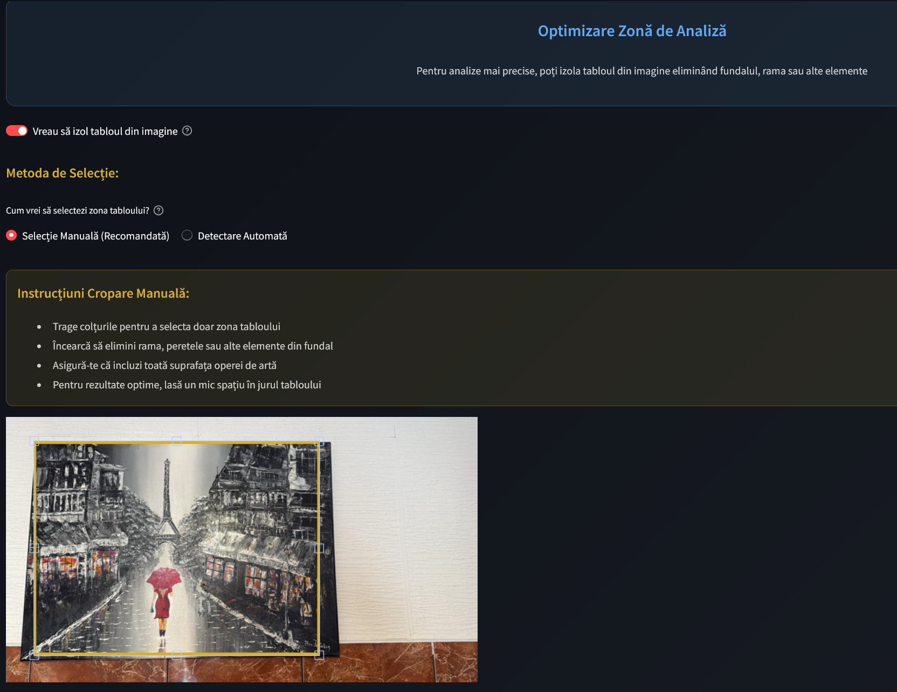
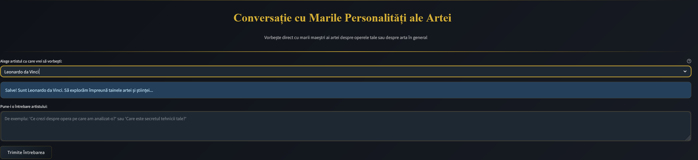
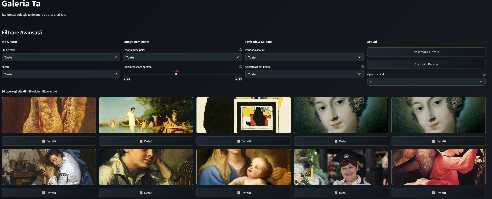
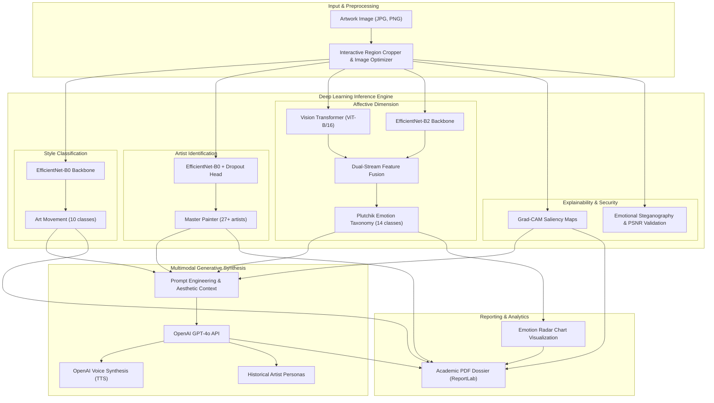

# 🎨 ArtAdvisor · Multimodal AI & Narrative Art Interpretation Assistant

[](https://www.python.org/)
[](https://pytorch.org/)
[](https://huggingface.co/)
[](https://pytorch.org/vision/stable/models.html)
[](https://streamlit.io/)
[](https://openai.com/)
[](LICENSE)

An end-to-end multimodal AI platform and research project developed as a **Bachelor Thesis** at the **Faculty of Automation and Computer Science, Technical University of Cluj-Napoca (TUCN)**.

ArtAdvisor integrates **Computer Vision**, a **Dual-Stream Deep Learning architecture (EfficientNet-B2 + Vision Transformer ViT-B/16)**, **Explainable AI (Grad-CAM)**, and **Multimodal Generative LLMs (OpenAI GPT-4o)** to classify artworks, analyze affective dimensions across Plutchik's taxonomy, interpret compositional saliency, and synthesize contextual narratives in real time.

---

## 📸 Application Interface & Visual Demonstrations

| Interactive Artwork Cropping & Analysis | Multimodal Artist Persona Dialog | Curated Masterpiece Exploration |
|:---:|:---:|:---:|
|  |  |  |

---

## 🏛️ System Architecture



---

## 📈 Empirical Model Evaluation & Test Benchmarks

The dual-stream ensemble model was evaluated on the independent test split of the curated WikiArt & ArtEmis dataset across all 14 affective categories:

| Emotion Category | F1-Score (Test) | Average Precision (AP) | Optimal Threshold |
|:---|:---:|:---:|:---:|
| **Anticipation** | **0.926** | **0.934** | 0.10 |
| **Surprise** | **0.895** | **0.949** | 0.10 |
| **Happiness** | **0.865** | **0.883** | 0.10 |
| **Trust** | **0.850** | **0.879** | 0.10 |
| **Optimism** | **0.848** | **0.851** | 0.10 |
| **Fear** | **0.733** | **0.717** | 0.18 |
| **Disgust** | **0.718** | **0.703** | 0.10 |
| **Sadness** | **0.710** | **0.673** | 0.24 |
| **Love** | **0.652** | **0.737** | 0.20 |
| **Gratitude** | **0.645** | **0.571** | 0.26 |
| **Pessimism** | **0.617** | **0.570** | 0.32 |
| **Agreeableness** | **0.554** | **0.445** | 0.12 |
| **Regret** | **0.493** | **0.384** | 0.22 |
| **Anger** | **0.448** | **0.383** | 0.34 |

---

## 📊 Curated Datasets & ML Engineering Pipeline

The models were trained on a curated collection of **14,000 classical art images**:
* **Source Collections:** WikiArt and ArtEmis benchmark datasets, cleaned and structured with metadata normalization.
* **10 Art Movements:** Baroque, Impressionism, Post-Impressionism, Surrealism, Expressionism, Realism, Romanticism, Symbolism, Art Nouveau, Renaissance.
* **30 Classical Painters:** Van Gogh, Monet, Rembrandt, Da Vinci, Picasso, Dalí, Renoir, Cézanne, Goya, Rubens, Beksiński, etc.
* **14 Affective Categories (Plutchik Taxonomy):** Mapped and verified against scientific metadata distributions.

---

## 🔬 Training & Experimentation Pipeline (`training/`)

This repository includes the complete end-to-end PyTorch training scripts used to build the thesis models:
* `1_curata_imagini.py` — ETL pipeline for metadata aggregation, image validation, and deduplication.
* `train_ensemble_model.py` — Dual-stream feature fusion training script (EfficientNet + ViT).
* `5_antreneaza_model_campion.py` — Fine-tuning pipeline with learning rate scheduling, data augmentation, and early stopping.
* `model_emotional_licenta_definitiv.py` — Definitive PyTorch architecture definition with custom batch normalization and dropout heads.
* `make_ch6_plots.py` — Generates ROC curves, Precision-Recall curves, confusion matrices, and calibration plots.

---

## 🛡️ Explainable AI & Security Features

* **Grad-CAM Saliency Maps:** Visualizes layer activations to identify regions influencing classifier decisions.
* **Emotional Steganography:** Digital watermarking hiding metadata within high-frequency image components with PSNR (Peak Signal-to-Noise Ratio) verification.
* **Adversarial Robustness Testing:** Evaluates model resilience against targeted adversarial noise (FGSM perturbations).

---

## 🚀 Quick Start Guide

### Prerequisites
* Python 3.10 or 3.11
* Virtual environment (`venv` or `conda`)
* OpenAI API Key (for LLM narrative generation and artist persona dialogs)

### 1. Clone the Repository
```bash
git clone https://github.com/GhileaLucian/ArtAdvisor.git
cd ArtAdvisor
```

### 2. Set Up Virtual Environment & Dependencies
```bash
python -m venv venv
# On Windows:
venv\Scripts\activate
# On Linux/macOS:
source venv/bin/activate

pip install -r requirements.txt
```

### 3. Configure API Secrets
Create `.streamlit/secrets.toml` from the example template:
```toml
OPENAI_API_KEY = "sk-proj-your-openai-api-key-here"
```

### 4. Run the Application
```bash
streamlit run app.py
```
Open [http://localhost:8501](http://localhost:8501) in your browser.

---

## 👤 Author

**Dan Lucian Ghilea**  
*MSc Student in Applied Informatics in Complex Systems · Technical University of Cluj-Napoca (TUCN)*  
* **LinkedIn:** [linkedin.com/in/lucian-ghilea](https://linkedin.com/in/lucian-ghilea)  
* **Email:** [danlucianghilea@gmail.com](mailto:danlucianghilea@gmail.com)  
* **GitHub:** [@GhileaLucian](https://github.com/GhileaLucian)

---

## 📄 License

This project is licensed under the [MIT License](LICENSE).
