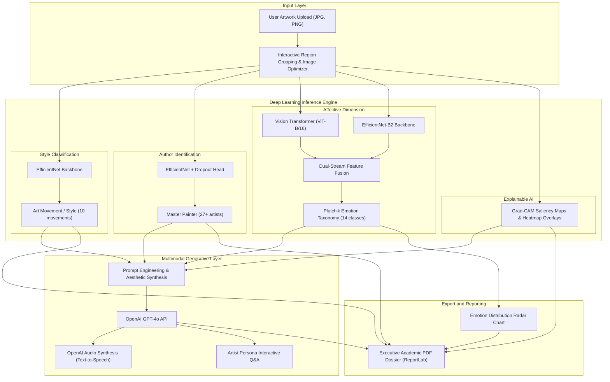

# 🎨 ArtAdvisor · Multimodal AI & Narrative Art Interpretation Assistant

[](https://www.python.org/)
[](https://pytorch.org/)
[](https://huggingface.co/)
[](https://streamlit.io/)
[](https://openai.com/)
[](LICENSE)

An end-to-end multimodal AI application developed as a **Bachelor Thesis Project** at the **Technical University of Cluj-Napoca (TUCN)**.

ArtAdvisor combines **computer vision**, **dual-stream deep neural networks**, and **multimodal generative LLMs** to classify classical artworks, predict affective and aesthetic dimensions, interpret visual attention through **Grad-CAM**, and synthesize rich contextual narratives in real time.

---

## 🏛️ System Architecture



---

## 📊 Curated Datasets & Machine Learning Methodology

The underlying models were trained on an aggregated and curated dataset of **14,000 classical art images**:
* **WikiArt Collection & ArtEmis Benchmark:** Cleaned, validated, and normalized across metadata distributions.
* **10 Art Movements:** Baroque, Impressionism, Post-Impressionism, Surrealism, Expressionism, Realism, Romanticism, Symbolism, Art Nouveau, Renaissance.
* **30 Classical Painters:** Van Gogh, Monet, Rembrandt, Da Vinci, Picasso, Dalí, Renoir, Cézanne, Goya, Rubens, Beksiński, etc.
* **14 Affective Categories (Plutchik-Inspired):** Sadness, Trust, Fear, Disgust, Anger, Anticipation, Happiness, Love, Surprise, Optimism, Gratitude, Pessimism, Regret, Agreeableness.

---

## ✨ Key Capabilities

1. **Dual-Stream Feature Fusion:** Combines convolutional localized spatial representations (EfficientNet-B2) with global contextual attention mechanisms (Vision Transformer ViT-B/16).
2. **Explainable AI (XAI):** Generates Grad-CAM activation heatmaps highlighting the exact compositional regions influencing model predictions.
3. **Adaptive Narrative Generation:** Translates technical model outputs into dynamic, engaging natural language across multiple stylistic tones (Poetic, Academic/Analytical, Curatorial).
4. **Interactive Artist Personas:** Conversational chat interface simulating historical masters (Van Gogh, Da Vinci, Monet, Picasso) powered by prompt-engineered LLM personas.
5. **Academic PDF Generation:** Programmatically compiles downloadable evaluation dossiers complete with visual heatmaps, prediction rankings, and generated narrative critiques.
6. **Audio Synthesis (TTS):** Narrates visual interpretations using synchronized speech synthesis.

---

## 🚀 Quick Start Guide

### Prerequisites
* Python 3.10 or 3.11 recommended.
* Virtual environment tool (`venv` or `conda`).
* OpenAI API Key (optional, required for generative narratives and chat).

### 1. Clone the Repository
```bash
git clone https://github.com/GhileaLucian/ArtAdvisor.git
cd ArtAdvisor
```

### 2. Set Up Virtual Environment & Install Dependencies
```bash
python -m venv venv
# On Windows:
venv\Scripts\activate
# On Linux/macOS:
source venv/bin/activate

pip install -r requirements.txt
```

### 3. Configure API Secrets
Create a `.streamlit/secrets.toml` file (copied from `.streamlit/secrets.toml.example`):
```toml
OPENAI_API_KEY = "sk-proj-your-api-key-here"
```

### 4. Run the Streamlit Application
```bash
streamlit run app.py
```
Open [http://localhost:8501](http://localhost:8501) in your browser.

---

## 🗂️ Project Structure

```
ArtAdvisor/
├── app.py                     # Streamlit application entry point & layout
├── config.py                  # Global configurations & artist personas
├── predict.py                 # Unified inference pipeline & preprocessing
├── requirements.txt           # Python package dependencies
├── predictors/                # PyTorch deep learning predictors
│   ├── style_predictor.py     # Art movement classifier & Grad-CAM
│   ├── author_predictor.py    # Painter identification model
│   └── emotion_predictor.py   # Dual-stream EfficientNet + ViT ensemble
├── ui_components/             # Modular Streamlit tab interfaces
│   ├── analysis_tab.py        # Core artwork analysis interface
│   ├── gallery_tab.py         # Curated masterpiece exploration
│   ├── search_tab.py          # Multimodal semantic search
│   └── artist_chat_tab.py     # Interactive LLM artist persona dialogs
├── utils/                     # Supporting utilities
│   ├── ai_services.py         # OpenAI GPT-4o narrative & audio synthesis
│   ├── data_management.py     # Metadata persistence & user feedback
│   ├── pdf_generator_advanced.py # Automated PDF report compiler
│   ├── visualizations.py      # Radar charts & affective distribution plots
│   └── emotion_database.json  # Affective taxonomy definitions
├── models/                    # Model serialization directory
└── static/                    # CSS stylesheets, branding & assets
```

---

## 👤 Author

**Dan Lucian Ghilea**  
*MSc Student in Applied Informatics in Complex Systems · Technical University of Cluj-Napoca (TUCN)*  
* **LinkedIn:** [linkedin.com/in/lucian-ghilea](https://linkedin.com/in/lucian-ghilea)  
* **Email:** [danlucianghilea@gmail.com](mailto:danlucianghilea@gmail.com)  
* **GitHub:** [@GhileaLucian](https://github.com/GhileaLucian)

---

## 📄 License

This project is licensed under the [MIT License](LICENSE).
